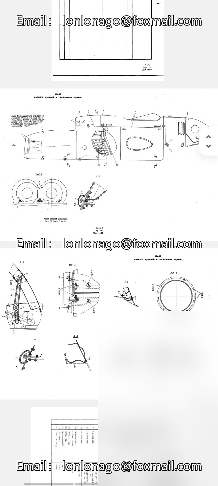
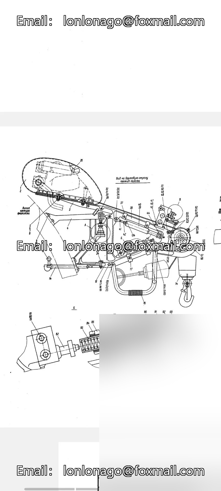
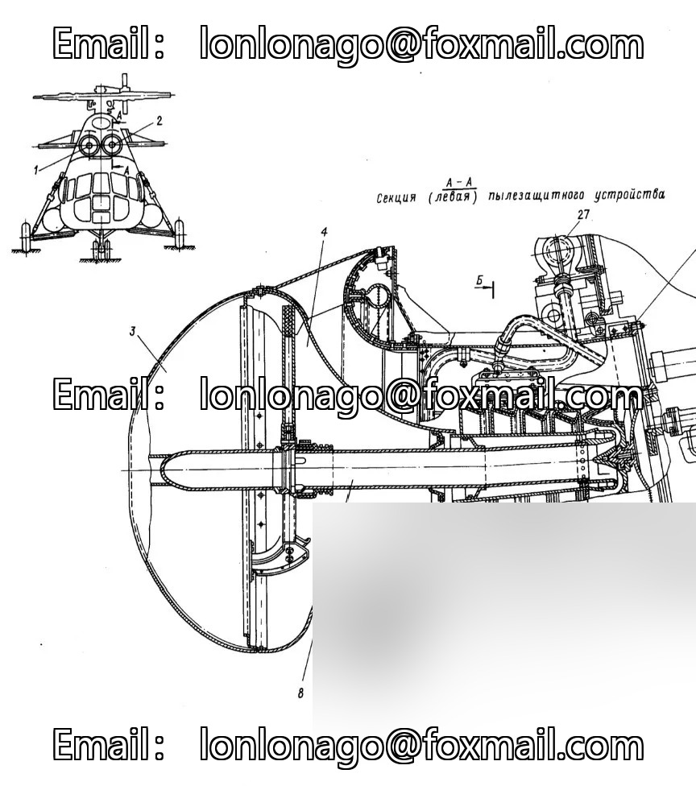
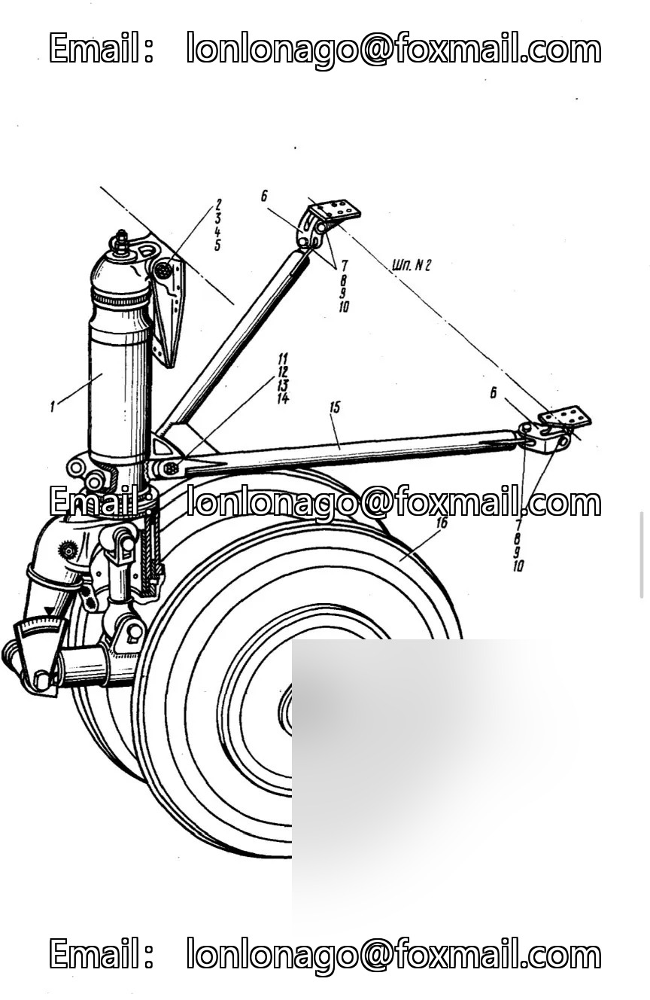
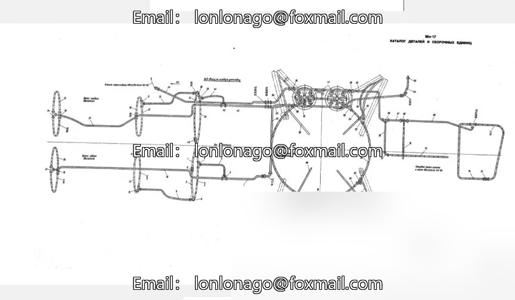
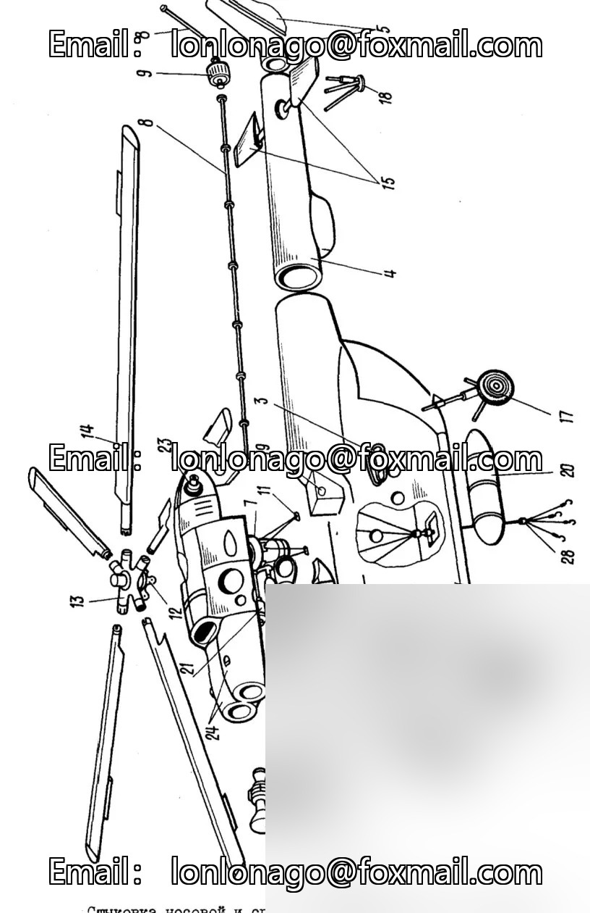

# M-8MTV-1 helicopter design materials

## Body

The design materials for the Mi-8MTV-1 helicopter, the Mi-8MTV-1 helicopter parts assembly catalog PDF , 630 pages, corresponding to the exported Mi-8MTV-1, an improved type of Mi-8T, equipped with a high-power engine, belonging to the same improvement series as Mi-8AMT.
mo.com
Material content:
- Fully covers detailed assembly relationships of the Mi-8MTV-1 helicopter's systems, components, and subassemblies
- Clear drawings with clear annotations, suitable for repair, modification, and research reference
- The appendix may contain supplementary information such as technical parameters, weight distribution, and material specifications

returned not after sale.

The material provides design assets for the Mi-8MTV-1 helicopter, covering systems, parts and integrated assemblies, along with an assembly directory and PDF; supplementary information such as material specs and technical parameters may appear in the appendix.

<!-- AI_ENRICHED -->

## Images

## Payment

Here is a pay link on Stripe ( https://buy.stripe.com/3cs8yP7sY87d0vu9AB ). Please contact me lonlonago@foxmail.com after funding $89, and I will send you a complete data files , thank you!

